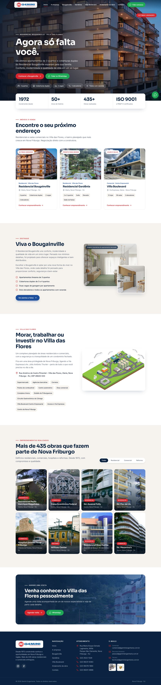

# Gemini Engenharia – site com Puck

Nova versão do site da [Gemini Engenharia](https://geminiengenharia.com.br), feita com o editor visual Puck. O conteúdo do site atual foi reorganizado num visual novo, e cada página pode ser editada no navegador, sem mexer em código.



## Páginas

| Endereço                    | Conteúdo                                                                               |
| --------------------------- | -------------------------------------------------------------------------------------- |
| `/`                         | Destaque do Bougainville, números, imóveis à venda, Villa das Flores, obras realizadas |
| `/a-empresa`                | História, números, certificações ISO 9001 e PBQP-H, portfólio                          |
| `/residencial-bougainville` | Diferenciais, galeria do decorado, plantas humanizadas, localização, contato           |
| `/residencial-gardenia`     | Apresentação, ficha técnica com plantas e acabamentos, galeria, contato                |
| `/villa-boulevard`          | Lojas e salas comerciais, vantagens, galeria, contato                                  |
| `/andamento-da-obra`        | Etapas da obra do Bougainville e do Gardênia, com percentual de cada uma               |
| `/contato`                  | Formulário por setor, telefones, e-mails e mapa                                        |

## Como rodar

Na raiz do repositório:

```sh
pnpm install
pnpm --filter gemini-engenharia dev
```

Abra [http://localhost:3000](http://localhost:3000).

## Como editar

Acrescente `/edit` ao fim de qualquer endereço (por exemplo `/residencial-gardenia/edit`). No editor dá para:

- trocar textos, fotos, botões, números e listas de cada bloco;
- arrastar blocos para mudar a ordem, ou adicionar novos pela barra da esquerda;
- criar uma página nova, abrindo um endereço que ainda não existe com `/edit` no final.

Clique em **Publish** para salvar. As páginas publicadas ficam em `database.json`. Uma página que nunca foi publicada usa o conteúdo inicial de `lib/default-pages.ts`.

## Blocos disponíveis

| Grupo             | Blocos                                                                                                                          |
| ----------------- | ------------------------------------------------------------------------------------------------------------------------------- |
| Estrutura do site | Cabeçalho, Rodapé                                                                                                               |
| Topo de página    | Destaque (topo), Cabeçalho de página                                                                                            |
| Conteúdo          | Imagem + texto, Diferenciais, Números, Frase de destaque, Chamada para ação                                                     |
| Imóveis e obras   | Imóveis à venda, Galeria de fotos (com ampliação), Ficha técnica, Localização, Andamento da obra, Obras realizadas (com filtro) |
| Contato           | Contato (formulário por setor)                                                                                                  |

O formulário de contato não precisa de servidor. Para **Vendas**, ele abre o WhatsApp da empresa com a mensagem já preenchida. Para os outros setores, abre o e-mail do setor.

## Arquivos

| Arquivo                | Função                                                                |
| ---------------------- | --------------------------------------------------------------------- |
| `puck.config.tsx`      | Registra os blocos, os campos editáveis e as categorias               |
| `components/`          | Os blocos do site                                                     |
| `app/styles.css`       | Todo o visual (cores, fontes, responsivo)                             |
| `lib/site.ts`          | Dados da empresa (telefones, e-mails, endereço) e endereços das fotos |
| `lib/default-pages.ts` | Conteúdo inicial de cada página                                       |
| `lib/get-page.ts`      | Lê as páginas publicadas ou o conteúdo inicial                        |

## Antes de colocar no ar

- **Proteja o editor.** As rotas `/edit` e `/puck/api` estão abertas. Adicione login antes de publicar o site.
- **Use um banco de dados.** `database.json` é um arquivo local e não funciona em hospedagens serverless.
- **Hospede as fotos.** As imagens são carregadas direto de `geminiengenharia.com.br/wp-content/uploads`. Se o site antigo sair do ar, elas somem; copie-as para o novo servidor ou para um serviço de imagens.
- **Confira os dados.** Status dos imóveis ("Últimas unidades", "Pronto para morar"), percentuais de obra e telefones foram tirados do site atual em novembro de 2026.
