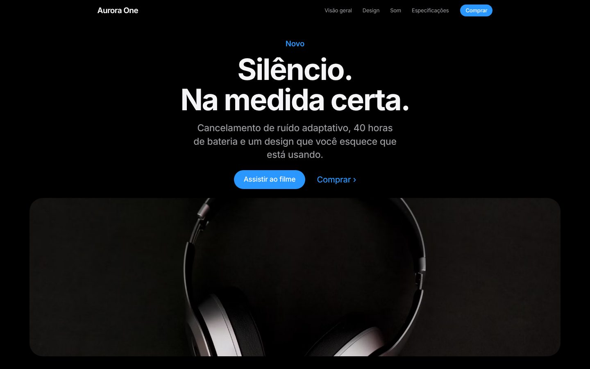

# Vitrine

Plataforma para agências criarem, editarem e publicarem sites dos seus clientes, com edição por IA própria e blocos no estilo de grandes lançamentos de produto: tipografia limpa, muito espaço em branco, rolagem cinematográfica, parallax, produto em 3D e storytelling visual.

Construída sobre o editor [Puck](../../packages/core) deste repositório. A IA é implementada aqui mesmo, chamando a API do Claude diretamente. Não usa o Puck AI nem a nuvem do Puck.



## O que o produto faz

| Área                | Recursos                                                                                                                                                                                                   |
| ------------------- | ---------------------------------------------------------------------------------------------------------------------------------------------------------------------------------------------------------- |
| **Vários clientes** | Cada site é um cliente (tenant). Usuários têm papel por site. A agência vê todos; o cliente só vê o dele.                                                                                                  |
| **Edição por IA**   | Painel "IA" no editor. A pessoa descreve a mudança e a página muda ao vivo, bloco a bloco. Entende o bloco selecionado ("mude este título"). Cria um site inteiro a partir de uma descrição do negócio.    |
| **Editor visual**   | Arrastar e soltar, campos em português, envio de imagens, cores, pré-visualização em celular, tablet e computador. Rascunho salvo automaticamente.                                                         |
| **Publicação**      | Rascunho e publicado separados. Publicar não precisa de deploy. Cada publicação vira uma versão.                                                                                                           |
| **Histórico**       | Painel "Versões" no editor: abrir qualquer versão no editor ou restaurar (republica sem apagar nada). Desfazer/refazer na sessão.                                                                          |
| **Papéis**          | Agência (todos os sites), Administrador do site (publica, restaura, domínios, equipe), Editor (edita e envia para revisão; não publica nem apaga blocos). Verificado no servidor em toda chamada.          |
| **Domínios**        | Domínio próprio do cliente com verificação por registro TXT e checagem de CNAME. Endereço provisório `<site>.<domínio raiz>`.                                                                              |
| **Contatos**        | O bloco "Formulário de contato" grava as mensagens no painel do cliente (aba Contatos), com limite de envio por IP.                                                                                        |
| **Rastreamento**    | Meta Pixel, Google Analytics 4, Google Ads, TikTok e Pinterest só com o ID, aviso de cookies (LGPD), conversão ao enviar o formulário, origem da campanha em cada contato e contagem de visitas no painel. |
| **WhatsApp**        | Balão verde fixo no canto de todas as páginas, com número, mensagem de abertura, texto ao lado do ícone e posição. Os cliques viram evento nas ferramentas de rastreamento.                                |
| **Atividade**       | Registro de publicações, restaurações, pedidos de revisão, uso da IA, domínios e acessos.                                                                                                                  |

## Blocos

| Categoria       | Bloco                                                                                                                  | O que faz                                                                                                                                                                               |
| --------------- | ---------------------------------------------------------------------------------------------------------------------- | --------------------------------------------------------------------------------------------------------------------------------------------------------------------------------------- |
| Cinematográfico | Abertura                                                                                                               | Estilo cinematográfico: a seção fica presa e a imagem cresce até a tela inteira enquanto o título se dissolve. Também "texto + imagem" e "só tipografia". Aceita vídeo.                 |
|                 | Produto em 3D                                                                                                          | Renderização 3D em tempo real (Three.js) que gira e aproxima com a rolagem, com legendas por etapa. Objetos gerados (smartphone, relógio, alto-falante, fone) ou modelo `.glb` próprio. |
|                 | História com rolagem                                                                                                   | Imagem presa de um lado, trocando suavemente a cada capítulo de texto.                                                                                                                  |
|                 | Parallax                                                                                                               | Imagem em profundidade com frase que surge ao rolar.                                                                                                                                    |
|                 | Frase que se revela                                                                                                    | As palavras acendem uma a uma conforme a rolagem.                                                                                                                                       |
|                 | Galeria horizontal                                                                                                     | A rolagem vertical move uma fileira de cartões na horizontal.                                                                                                                           |
| Conteúdo        | Grade de recursos                                                                                                      | Mosaico estilo bento com números, imagens e frases, animado ao entrar na tela.                                                                                                          |
|                 | Imagem + texto, Números (contagem animada), Especificações, Galeria (com ampliação), Depoimentos, Perguntas frequentes |                                                                                                                                                                                         |
| Conversão       | Compra / chamada final                                                                                                 | Preço, amostras de cor e botões.                                                                                                                                                        |
|                 | Formulário de contato                                                                                                  | Salva os contatos no painel.                                                                                                                                                            |
| Estrutura       | Menu, Rodapé, Espaço                                                                                                   |                                                                                                                                                                                         |

Configurações de página: tema claro ou escuro, cor de destaque, tipografia (limpa, editorial serifada ou geométrica), título e descrição para o Google. Qualquer seção pode usar o tema invertido, suave ou a cor de destaque, para criar contraste.

As animações rodam sem bibliotecas: o progresso da rolagem vira uma variável CSS atualizada por `requestAnimationFrame`, então o React não renderiza de novo durante a rolagem. Quem pede movimento reduzido no sistema recebe a página estática.

## Personalização

Tudo é ajustável em três níveis, sem código e sem deploy. A IA enxerga os mesmos campos e usa todos eles.

**1. Página inteira** (clique fora de qualquer bloco): título e imagem de compartilhamento para o Google; tema claro, escuro ou automático; cor de destaque, de fundo e de texto; combinação de fontes ou fonte própria para títulos e texto (14 famílias, carregadas só quando usadas); peso e tamanho dos títulos; cantos arredondados; formato dos botões; largura do conteúdo; espaço entre seções; animações de rolagem ligadas ou desligadas; e CSS próprio como último recurso (sem `@import`, scripts nem HTML).

**2. Estilos prontos** (aba "Design" do editor): seis pontos de partida (claro e limpo, escuro cinematográfico, editorial, ousado, suave e quente, tech). Aplicam-se à página aberta e, com um clique, ao rascunho de todas as outras páginas do site.

**3. Cada bloco** (grupo "Estilo e espaçamento" de todo bloco): espaço acima e abaixo, largura, alinhamento do texto, cor de fundo e de texto, imagem de fundo com escurecimento (o texto vira claro sozinho), animação de entrada (aparecer, subir, zoom, deslizar ou nenhuma), esconder no celular ou no computador e âncora para links. Além disso, cada bloco tem as próprias opções: a Abertura, por exemplo, escolhe o tamanho da foto ao abrir (pequena, média, grande, tela toda), o tamanho do título e o enquadramento da foto.

**Tamanho livre, de três jeitos equivalentes.** Qualquer tamanho aceita valor exato, não só presets, e os três caminhos escrevem os mesmos campos:

- **Mouse:** selecione um bloco e arraste as alças nas bordas. Topo e base mudam o espaço (`spaceTopPx`, `spaceBottomPx`); laterais mudam a largura do conteúdo (`widthPx`). Na Imagem, as laterais mudam `widthPct` e a base muda `heightPx`; na Abertura cinematográfica, as laterais e a base da foto mudam `mediaInset` e `mediaInsetBottom`. A medida aparece enquanto arrasta, `Esc` cancela e cada arrasto vira um único passo de desfazer.
- **Barra lateral:** os mesmos campos têm controle deslizante e caixa numérica para o valor exato, com "Automático" para voltar ao padrão.
- **IA:** peça "deixe a foto com 70% da largura" ou "aumente o espaço abaixo para 160 px"; a IA grava os mesmos números.

Blocos livres para montar qualquer tipo de site: **Texto**, **Imagem**, **Cartões**, **Planos e preços**, **Logos de clientes**, **Vídeo ou mapa** (YouTube, Vimeo, Loom, Google Maps, OpenStreetMap, Calendly, sempre isolados) e **Divisor**, além dos blocos cinematográficos.

Por segurança, não existe bloco de HTML ou script livre: os sites rodam no mesmo domínio do painel, e um script de um cliente poderia atacar os outros. O CSS próprio é limpo antes de ir ao ar.

## Como a IA funciona

1. O painel envia o pedido, a página atual (JSON), o bloco selecionado e as últimas mensagens para `/api/ai`.
2. O servidor confere login e papel e chama a OpenRouter com o modelo escolhido para aquele cliente (streaming) com seis ferramentas: `insert_block`, `update_block`, `remove_block`, `move_block`, `update_page` e `replace_content`.
3. Cada chamada de ferramenta é validada contra o esquema dos blocos (`blocks/schema.ts`). Uma entrada inválida volta para a IA como erro e ela corrige sozinha.
4. Cada mudança aceita é enviada ao editor na hora (a página muda enquanto a IA trabalha). No fim, a alteração inteira vira um passo de desfazer.
5. A IA nunca publica. O resultado fica no rascunho até alguém publicar.

O esquema dos blocos é a fonte única: gera os campos do editor, a validação e o catálogo que a IA lê. Um bloco novo aparece para a IA automaticamente.

O prompt de sistema traz uma direção de arte (ritmo das seções, títulos curtos, contraste, uma ideia por seção) e uma biblioteca de imagens verificadas. Ele é estável e vai com cache. A IA está instruída a não inventar fatos verificáveis sobre negócios reais e a marcar dados que faltam como provisórios.

### Motor Claude Code (opcional)

Em vez do laço próprio de ferramentas, a edição pode rodar no **Claude Code** (Claude Agent SDK) dentro do seu servidor. Ele continua usando a OpenRouter e o modelo escolhido para cada cliente, e passa a ler **skills do projeto**:

```sh
VITRINE_AI_ENGINE=claude-code
```

- **Skills em `ai/claude/.claude/skills/`.** `direcao-de-arte` (o ritmo das seções, os títulos, o contraste) e `sobre-a-agencia` (tom de voz, palavras proibidas, padrões de texto da agência). Edite o `SKILL.md` e a próxima chamada da IA já usa a versão nova, sem deploy. Para uma skill nova, crie a pasta e acrescente o nome em `SKILL_NAMES` (`ai/claude-code.ts`). Só as skills listadas ali ficam visíveis para a IA.
- **As mesmas seis ferramentas e a mesma validação** de página. O resto do pipeline não muda: a página muda ao vivo, vira um passo de desfazer e nunca publica sozinha.
- **Sem acesso a nada além do site.** O processo não tem terminal, arquivos, internet nem outros servidores MCP, e recebe só a chave da OpenRouter (nenhum outro segredo do servidor). Mesmo assim, não coloque segredos nas skills.
- **Créditos pelo consumo real.** Cada resposta do modelo é cobrada pelos tokens informados, com leitura de cache pesando 0,1x e escrita de cache 1,25x. Com o motor ligado, a primeira chamada de cada pedido custa mais (monta o cache) e as seguintes custam pouco.
- **Autenticação por chave de API (OpenRouter).** Não use a assinatura Claude Pro/Max para atender clientes: ela é de uso pessoal.
- **Precisa de servidor sempre ligado** (VPS ou container), porque o Claude Code roda como processo. Não funciona em hospedagem serverless.

| Variável                 | Para quê                                                                                  |
| ------------------------ | ----------------------------------------------------------------------------------------- |
| `VITRINE_AI_ENGINE`      | `claude-code` liga este motor. Vazio mantém o motor padrão.                               |
| `VITRINE_SKILLS_DIR`     | Pasta que contém `.claude/skills` (padrão `ai/claude`, relativa à pasta do app).          |
| `VITRINE_AI_SMALL_MODEL` | Modelo barato para tarefas internas do Claude Code (padrão `anthropic/claude-haiku-5.5`). |

### Modelo por cliente e créditos

Todas as chamadas passam pela OpenRouter, então qualquer modelo dela serve. No painel, a agência abre **IA e créditos** (menu superior) e:

- escolhe o **modelo de cada cliente** (ou deixa o padrão da plataforma);
- mantém o **catálogo de modelos**: identificador da OpenRouter, nome, preço em créditos por 1 milhão de tokens (entrada e saída separados) e se está ativo;
- **adiciona ou ajusta créditos** de cada cliente, com observação, e vê o extrato de movimentos.

Cada chamada ao modelo é cobrada pelos tokens que o provedor informou (entrada e saída), arredondando para cima, com mínimo de 1 crédito. O saldo aparece no painel de IA do editor e cai a cada passo do agente. Com saldo zero a IA é bloqueada antes de chamar o modelo e, se acabar no meio de um pedido, o que já foi feito fica no rascunho. Todo uso fica registrado (modelo, tokens, créditos, quem pediu) e administradores do cliente veem o próprio extrato na aba "IA e créditos" do site. Sites novos recebem `VITRINE_FREE_CREDITS` (padrão 1000).

O catálogo inicial traz Claude Sonnet 5.5 (padrão), Claude Opus 5.5, GPT-6.1 Terra, Gemini 3.8 Flash e Claude Haiku 5.5. Em bancos criados com o catálogo antigo, o servidor adiciona esses modelos uma única vez na inicialização e desativa os antigos (Claude Sonnet 4.5, Claude Opus 4.1, Gemini 2.5 Flash e GPT-4o mini) que nenhum cliente usa. Clientes que escolheram um modelo antigo continuam com ele até a agência trocar.

Os preços iniciais são exemplos (1 crédito = US$ 0,001, sem margem): confira os preços atuais na OpenRouter e defina os seus acima do custo. Uma chamada interrompida pelo usuário só é cobrada se o provedor já tiver informado o uso.

## Rastreamento e visitas

Aba **Rastreamento** do site (administradores) e aba **Visitas** (todos). Equivalente ao PixelYourSite, mas **sem o cliente colar script**: ele digita só o ID de cada ferramenta.

| Ferramenta                                     | O que o cliente informa                                |
| ---------------------------------------------- | ------------------------------------------------------ |
| Meta Pixel (Facebook e Instagram)              | ID do pixel (só números)                               |
| Google Analytics 4                             | ID da métrica (`G-…`)                                  |
| Google Ads                                     | ID da tag (`AW-…`) e, opcional, o rótulo da conversão  |
| TikTok Pixel e Pinterest Tag                   | ID do pixel / da tag                                   |
| Search Console e domínio do Meta (verificação) | O valor do meta tag (não precisa de aceite de cookies) |

**Por que só o ID.** Cada ID é validado no formato da plataforma e encaixado no código oficial, que mora em `lib/tracking.ts`. Um script colado é recusado. O código que roda nos sites é sempre o do sistema, e um cliente não consegue atacar o painel nem os outros clientes por aqui.

- **Consentimento (LGPD).** Com a opção ligada (padrão), um aviso de cookies aparece e **nenhuma ferramenta de terceiros carrega antes do "Aceitar"**. A escolha fica no navegador, e um botão "Cookies" permite mudar. Recusar depois de aceitar recarrega a página sem as ferramentas. Sem nenhum ID configurado, não há aviso.
- **Eventos.** PageView automático. O envio do formulário de contato vira Lead no Meta, `generate_lead` (e a conversão, se houver rótulo) no Google, SubmitForm no TikTok e lead no Pinterest. Cliques nos botões principais viram `cta_click` / CTAClick.
- **Origem em cada contato.** UTM, `gclid`, `fbclid`, `ttclid` e o site de origem ficam guardados só na aba do navegador e vão com o formulário. A aba Contatos mostra a coluna **Origem** (por exemplo `google / cpc`).
- **Visitas.** Contador por dia, página e origem, **sem cookies, sem IP e sem dado pessoal**. Robôs de busca e monitores não entram. Só páginas publicadas contam. Não distingue visitantes únicos: é a contagem de aberturas de página.
- **Código próprio (só equipe da agência).** Para Google Tag Manager, chat e o que não tem campo, a conta de agência pode colar HTML no `<head>` do site. Carrega depois do aceite de cookies. **Cole só código de fonte confiável:** ele roda com o mesmo poder do site, e no endereço provisório o site divide o domínio com o painel. A trava é no servidor: cliente, mesmo administrador do site, não consegue salvar esse campo.

Não faz (ainda): envio de conversões pelo servidor (Meta Conversions API) e eventos personalizados por regra, como "rolou 75% da página".

## Balão de WhatsApp

Aba **WhatsApp** do site (administradores). O cliente digita o número com DDD, como `(11) 91234-5678`, e escolhe a mensagem que a conversa já abre, o texto ao lado do ícone e o canto da tela. Número em branco desliga o balão.

- **É só um link `wa.me`.** Sem script e sem incorporar nada, então funciona mesmo antes da escolha de cookies. Abre em nova aba, sem repassar a página de origem (`noopener`).
- **Número.** Aceita qualquer formato. Sem `+`, 10 ou 11 dígitos viram Brasil (`55` na frente). Fora do Brasil, comece com `+` e o código do país. O que não parece telefone é recusado, e a mensagem é codificada na URL.
- **Onde aparece.** Em todas as páginas (padrão), só nas marcadas, ou em todas menos as marcadas, escolhendo na lista de páginas do site. Serve, por exemplo, para esconder o balão na página de agradecimento. Os caminhos seguem a mesma regra dos nomes de página do site.
- **Horário de atendimento.** Opcional. Janela de abertura e fechamento **por dia da semana**, lida no **fuso do negócio** (Brasília, Manaus, Cuiabá, Rio Branco, Noronha ou Lisboa), não no do visitante. A abertura vale a partir do minuto marcado e o fechamento já está fora. Para atender de madrugada, use o fechamento antes da abertura (22:00 até 02:00 cobre a manhã seguinte). Fora do horário o balão **some** ou **continua com outra mensagem e outro texto** ("Deixe sua mensagem"), à escolha. O painel avisa se agora é horário de atendimento.
- **Sem JavaScript.** As duas regras são avaliadas no servidor a cada visita, então o balão continua sendo um link simples. A página é renderizada a cada acesso, então o balão acompanha o relógio.
- **Celular.** Só o ícone (alvo de toque de 58 px). Se o aviso de cookies estiver aberto, o balão sobe para não ficar embaixo dele, e o botão "Cookies" vai para o lado oposto ao do balão.
- **Rastreamento.** O clique vira `Contact` no Meta e no TikTok, `whatsapp_click` no Google e um evento personalizado no Pinterest, quando essas ferramentas estão configuradas e aceitas. Não conta como Lead do formulário.
- **Conversão do Google Ads.** Na aba Rastreamento há um rótulo de conversão **só para cliques no WhatsApp**, separado do rótulo do formulário. O sistema recusa o mesmo rótulo nos dois campos, para um contato não contar em dobro. Sem o rótulo, o clique não é conversão.
- **Contagem própria.** Cada clique entra na aba **Visitas** (cartão "Cliques no WhatsApp" e tabela por origem, como `instagram / social`). Segue as regras das visitas: sem cookies e sem dado pessoal, **não espera o aceite de cookies**, ignora robôs, só conta páginas publicadas e respeita a opção "Contar visitas no painel".

## Rodar

Na raiz do repositório:

```sh
pnpm install
cp apps/vitrine/.env.example apps/vitrine/.env.local   # e preencha OPENROUTER_API_KEY
pnpm --filter vitrine dev
```

Abra [http://localhost:3000](http://localhost:3000). O banco é criado em `apps/vitrine/data/` no primeiro acesso, com dois sites de demonstração:

| Conta                   | Senha        | Acesso                                     |
| ----------------------- | ------------ | ------------------------------------------ |
| `admin@vitrine.app`     | `vitrine123` | Agência: todos os sites, cria sites        |
| `cliente@gemini.com.br` | `vitrine123` | Administrador do site Gemini Engenharia    |
| `editor@gemini.com.br`  | `vitrine123` | Editor do site Gemini (envia para revisão) |

Sites publicados: `/sites/aurora` (lançamento de produto) e `/sites/gemini` (construtora).

Sem `OPENROUTER_API_KEY`, tudo funciona menos a IA, e o painel avisa o que falta. `VITRINE_AI_MOCK=1` liga um modo de teste que entende poucas frases e serve só para testar o fluxo sem chave.

## Variáveis de ambiente

| Variável                                       | Para quê                                                               |
| ---------------------------------------------- | ---------------------------------------------------------------------- |
| `OPENROUTER_API_KEY`                           | Liga a edição por IA.                                                  |
| `VITRINE_AI_MODEL`                             | Modelo padrão da plataforma (id da OpenRouter).                        |
| `VITRINE_FREE_CREDITS`                         | Créditos de boas-vindas de cada site novo (padrão 1000).               |
| `VITRINE_ROOT_DOMAIN`                          | Domínio raiz da plataforma. Sites ficam em `<slug>.<raiz>`.            |
| `VITRINE_APP_HOSTS`                            | Hosts do painel, separados por vírgula (padrão `localhost,127.0.0.1`). |
| `VITRINE_CNAME_TARGET`                         | Destino do CNAME que os clientes configuram (padrão `sites.<raiz>`).   |
| `VITRINE_PLATFORM_IP`                          | IP aceito em registro A, para domínios sem www.                        |
| `VITRINE_DATA_DIR`                             | Pasta do banco e dos arquivos enviados (padrão `./data`).              |
| `VITRINE_ADMIN_EMAIL`, `VITRINE_DEMO_PASSWORD` | Conta inicial da agência e senha das contas de demonstração.           |
| `VITRINE_HIDE_DEMO`                            | Esconde a lista de contas de demonstração no login.                    |

## Testes

```sh
pnpm --filter vitrine test
```

- `tests/page-ops.test.ts`: as operações da IA (inserir, editar, mover, remover, reconstruir), a validação, os modelos e o catálogo.
- `tests/design.test.ts`: os controles de personalização (props comuns, configurações da página, blocos novos, links incorporados, limpeza do CSS, estilos prontos e preenchimento de campos novos em páginas antigas).
- `tests/agent.test.ts`: roda o agente real (cliente da OpenRouter, streaming, ferramentas, cobrança de créditos) contra um servidor falso da API. Confere o formato do pedido, a cobrança por turno, a correção após um erro e o bloqueio sem créditos.

## Arquitetura

| Caminho                       | Função                                                         |
| ----------------------------- | -------------------------------------------------------------- |
| `blocks/schema.ts`            | Definição de todos os blocos (fonte única).                    |
| `blocks/components/`          | Renderização dos blocos. `three-scene.ts` é o renderizador 3D. |
| `blocks/motion.ts`            | Animação por rolagem, revelação e etapa ativa.                 |
| `blocks/site.css`             | Visual dos sites (temas, tipografia, animações).               |
| `ai/page-ops.ts`              | Operações puras e validadas sobre a página.                    |
| `ai/agent.ts`, `ai/prompt.ts` | Agente de IA e prompt de sistema.                              |
| `lib/db.ts`, `lib/repo.ts`    | Banco SQLite e regras de negócio (papéis, versões, domínios).  |
| `proxy.ts`                    | Encaminha domínios de clientes para o site certo.              |
| `app/(dash)`, `app/(editor)`  | Painel e editor.                                               |
| `app/sites`, `app/domain`     | Sites publicados (por endereço e por domínio).                 |

## Produção

| Tema               | Como funciona                                                                                                                                                                                                                                                                      |
| ------------------ | ---------------------------------------------------------------------------------------------------------------------------------------------------------------------------------------------------------------------------------------------------------------------------------- |
| Banco              | SQLite via `better-sqlite3` (estável, modo WAL), em `VITRINE_DATA_DIR`. Atende muito bem uma instância com disco persistente. Para várias instâncias, troque `lib/db.ts` por Postgres; o resto do código usa só `lib/repo.ts`.                                                     |
| Imagens enviadas   | Com `VITRINE_S3_BUCKET`, vão para qualquer serviço compatível com S3 (AWS S3, Cloudflare R2, MinIO). Sem ele, ficam em disco e são servidas por `/media`.                                                                                                                          |
| Convites e senhas  | Convites e redefinição de senha por link de uso único (guardado só como hash, expira em 7 dias / 2 horas). Com `RESEND_API_KEY`, os links vão por e-mail; sem ele, o painel mostra o link para o administrador enviar.                                                             |
| HTTPS dos domínios | Na Vercel (`VERCEL_TOKEN` + `VERCEL_PROJECT_ID`), cada domínio adicionado é ligado ao projeto e a Vercel emite o certificado. Em servidor próprio, use o `deploy/Caddyfile`: o Caddy emite certificados sob demanda e pergunta a `/api/tls/check` se o domínio pertence a um site. |
| Edição por IA      | `OPENROUTER_API_KEY`. Sem a chave, o resto do produto funciona e o painel avisa o que falta.                                                                                                                                                                                       |

Variáveis extras: `VITRINE_APP_URL` (endereço do painel, usado nos links de convite), `VITRINE_S3_BUCKET`, `VITRINE_S3_REGION`, `VITRINE_S3_ENDPOINT`, `VITRINE_S3_PUBLIC_URL` (mais as credenciais padrão `AWS_ACCESS_KEY_ID` e `AWS_SECRET_ACCESS_KEY`), `RESEND_API_KEY`, `VITRINE_MAIL_FROM`, `VERCEL_TOKEN`, `VERCEL_PROJECT_ID`, `VERCEL_TEAM_ID`.
